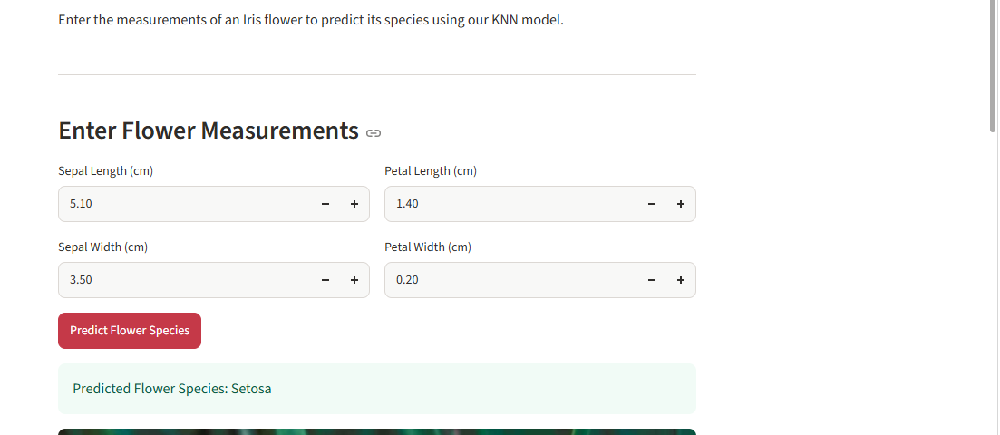

# Iris Flower Classification Using K-Nearest Neighbors (KNN)
https://iris-flower-classification-tctvdjfgohrwsybbrer7l2.streamlit.app/
## Application Preview

## Project Overview

This project involves developing a Machine Learning classification model that predicts the species of an Iris flower based on four physical measurements.

The model uses the K-Nearest Neighbors (KNN) algorithm to classify flowers into three species: Iris-setosa, Iris-versicolor, and Iris-virginica.

## Project Objectives

- Explore and understand the Iris dataset.
- Perform data preprocessing and feature scaling.
- Split the dataset into training and testing sets.
- Develop and train a KNN classification model.
- Evaluate the model's performance.
- Visualize the classification results.
- Make predictions using new flower measurements.
- Save and reload the trained model.

## Dataset Description

The project uses the Iris dataset available through Scikit-learn.

The dataset contains:
- 150 observations.
- 4 numerical features.
- 3 target classes.

### Features
1. Sepal Length (cm)
2. Sepal Width (cm)
3. Petal Length (cm)
4. Petal Width (cm)

### Target Classes
- Iris-setosa
- Iris-versicolor
- Iris-virginica

## Technologies and Libraries

- Python
- Google Colab
- Pandas
- NumPy
- Matplotlib
- Seaborn
- Scikit-learn
- Joblib

## Project Workflow

1. Dataset loading and exploration.
2. Data preprocessing.
3. Splitting the dataset into training and testing sets.
4. Feature standardization using StandardScaler.
5. Building the KNN classification model.
6. Training the model.
7. Making predictions.
8. Evaluating model performance.
9. Visualizing results using a confusion matrix and heatmap.
10. Testing the model with new flower measurements.
11. Saving and reloading the trained model.

## Model Evaluation

## Model Evaluation and Performance

The K-Nearest Neighbors (KNN) model was evaluated using a test dataset of 30 samples.

### Accuracy

The model achieved an accuracy of **93.33%**.

### Confusion Matrix

| Actual / Predicted | Setosa | Versicolor | Virginica |
|---|---:|---:|---:|
| Setosa | 10 | 0 | 0 |
| Versicolor | 0 | 10 | 0 |
| Virginica | 0 | 2 | 8 |

### Classification Report

| Class | Precision | Recall | F1-score |
|---|---:|---:|---:|
| Setosa | 1.00 | 1.00 | 1.00 |
| Versicolor | 0.83 | 1.00 | 0.91 |
| Virginica | 1.00 | 0.80 | 0.89 |

### Performance Interpretation

The model correctly classified 28 out of 30 test samples.

It achieved perfect classification of Iris-setosa and correctly identified all Iris-versicolor samples.

However, two Iris-virginica samples were misclassified as Iris-versicolor.

Overall, the model demonstrated strong classification performance with an accuracy of 93.33%.

## Model Prediction

The trained model was tested using new flower measurements and successfully predicted the Iris-setosa species.

## Model Persistence

The trained KNN model and fitted StandardScaler were saved using Joblib, allowing them to be loaded and reused without retraining.

## Project File

`iris_flower_classification.ipynb` - Contains the complete project implementation, code, and outputs.

## Author

**Nwonu Ikenna Basil**

Plant Science and Biotechnology Student | Machine Learning Enthusiast
